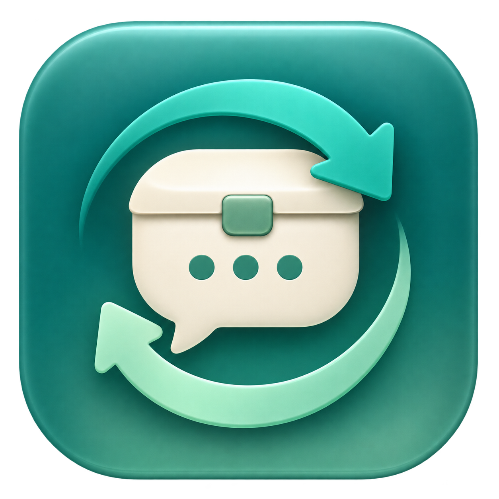

<!-- monorepo-migration:start -->
> [!IMPORTANT]
> **本專案已遷移至 monorepo-side-project。**
>
> 自 2026-11-16 起，本儲存庫停止維護並封存，僅保留歷史紀錄；後續開發與更新請使用新儲存庫。
>
> **新專案目錄：** [`projects/transfer-bk-session`](https://github.com/awtw/monorepo-side-project/tree/main/projects/transfer-bk-session)
>
> **新儲存庫：** [awtw/monorepo-side-project](https://github.com/awtw/monorepo-side-project)。此為私人儲存庫，需具備存取權限才能開啟。
<!-- monorepo-migration:end -->

---

<p align="center"></p>

# Session Porter

**把開發脈絡帶著走。** 原生 macOS App，用來瀏覽、備份與匯入 **Codex、Claude Code、OpenCode** 的本機 Session，並管理它們的實際儲存位置。

Native macOS session backup and transfer for Codex, Claude Code, and OpenCode. Runs locally; no account, cloud upload, or AI API required by Session Porter.

[下載版本](https://github.com/awtw/transfer-bk-session/releases) · [詳細安裝](docs/INSTALL.md) · [使用教學](docs/USER_GUIDE.md) · [常見問題](docs/TROUBLESHOOTING.md) · [更新紀錄](CHANGELOG.md)

> **目前版本：0.2.2，早期測試版。** 支援 macOS 14 Sonoma 以上與 Apple Silicon／Intel。安裝包尚未使用 Developer ID 簽署及 Apple 公證，可能被 Gatekeeper 阻擋；安裝前請閱讀[首次開啟說明](docs/INSTALL.md#首次開啟與-macos-安全性提示)。原工具資料格式會變動，跨 Mac 實際接續仍需使用者驗證，請保留原始資料。

## 可以做什麼？

| 功能 | 說明 |
| --- | --- |
| Session 瀏覽 | 顯示標題、工具、Session ID、專案、更新時間與封存狀態；搜尋與勾選多筆 |
| 匯出至外接硬碟 | 產生 `.sessionpack` 備份包，保存可辨識的對話、相關 metadata 與附件 |
| 運行中備份 | 原工具可以繼續執行；讀取已落盤內容的快照，不停止原 Session |
| 匯入預覽 | 支援備份包及既有資料夾，先比較本機內容並顯示目的地 |
| 重複處理 | 選擇合併、覆蓋或略過；分歧預設保留本機，覆蓋前建立復原副本 |
| 路徑對應 | 兩台 Mac 的專案位置不同時，可設定結構化路徑對應 |
| 儲存位置管理 | 顯示工具路徑與實際路徑；可驗證搬移至另一顆磁碟、建立連結及回復 |

**範圍：同一工具跨機搬移。** 不會將 Codex 的對話轉成 Claude/OpenCode 格式，也不備份 Claude.ai 雲端聊天。Session 備份不等於整個開發環境；專案原始碼、未提交變更、依賴、登入與外部檔案要另外準備。

## 五分鐘開始

1. 到 [Releases](https://github.com/awtw/transfer-bk-session/releases)，下載 `SessionPorter-0.2.2-macOS.pkg` 與對應 `.sha256`。不要把 GitHub 自動產生的 **Source code** 當成安裝檔。
2. 依[安裝教學](docs/INSTALL.md)校驗檔案、安裝並開啟 `/Applications/SessionPorter.app`。一般使用者不需要 Xcode、Python、Node 或 Apple Developer 帳號。
3. 進入「儲存位置」確認資料根目錄，回列表勾選 Session →「匯出到外接硬碟」。原工具可保持開啟。
4. 在另一台 Mac 準備相同版本的原工具與專案檔案；啟動原工具一次後完整結束。
5. 開啟 Session Porter →「匯入備份／資料夾」→ 檢查目的地、專案路徑對應與重複處理 → 匯入 → 重新開啟原工具接續。

匯出後新增的進度**不會自動更新備份**，需再次匯出。匯入實際寫入、搬移及回復前，請結束相關原工具與背景程序。

## 重複 Session 如何處理？

| 比較結果 | 預設「合併」的行為 |
| --- | --- |
| 本機沒有 | 新增，保留 Session ID |
| 內容相同 | 略過，不建立重複 Session |
| 備份完整包含本機歷史 | 採用較完整的備份歷史 |
| 本機完整包含備份歷史 | 保留本機並略過 |
| 兩邊各自發展、內容分歧 | 不自動拼接，保留本機；可另選覆蓋 |

「覆蓋」不是逐筆人工選擇訊息合併。它會替換選定 Session 的資料，並保留操作前復原副本；其他 Session 與共享專案資料受到保護。詳見[匯入與合併](docs/USER_GUIDE.md)。

## 預設資料位置

| 工具 | 資料根目錄 | 已知格式 |
| --- | --- | --- |
| Codex | `$CODEX_HOME` 或 `~/.codex` | `sessions` / `archived_sessions` JSONL、已知 SQLite metadata |
| Claude Code | `$CLAUDE_CONFIG_DIR` 或 `~/.claude` | `projects` JSONL、fork、子代理、Session file-history |
| OpenCode | `$XDG_DATA_HOME/opencode` 或 `~/.local/share/opencode` | `opencode.db` 中已知 `session` schema |

Finder 開啟的 App 不一定繼承終端機環境變數。自訂位置請在「儲存位置 → 掃描來源 → 指定資料根目錄」設定。完整支援範圍與限制見[相容性文件](docs/COMPATIBILITY.md)。

## 隱私與限制

- App 的 Session 作業在本機完成，沒有帳號登入、遙測或雲端同步服務。
- 可攜式匯出採白名單，排除已知登入檔與憑證表；**對話內容本身可能含敏感資料，備份包未加密**。
- 搬移整個資料根目錄、匯入前的本機資料庫復原快照，可能包含登入或憑證資料，請妥善保管。
- 每個檔案與資料庫各自取一致快照；不是多檔案的全域原子時間點。尚未落盤內容不會被備份。
- 無法保證所有原工具版本、外部附件或進階功能可還原；未知 schema 會停止，完整清單見[相容性文件](docs/COMPATIBILITY.md)。

## 開發與參與

```sh
git clone https://github.com/awtw/transfer-bk-session.git
cd transfer-bk-session
bash scripts/test.sh
bash scripts/build-app.sh
bash scripts/package-pkg.sh
```

開發需要完整 Xcode；專案包含產生好的 `.xcodeproj`，一般編譯不需要 XcodeGen。詳見[開發、簽署與發布](docs/DEVELOPMENT.md)。

0.2.2 的 60 項 XCTest 已在開發環境通過；已驗證通用 Release 編譯、安裝包結構及特定實際 Session 的唯讀匯出。這不等於所有 macOS／工具版本與兩台實機接續都已驗證。請參考[貢獻方式](CONTRIBUTING.md)回報可重現的問題，勿附上真實對話、token 或完整資料庫。

## 授權與聲明

[MIT License](LICENSE)，Copyright © 2026 awtw。App icon 為本專案使用 AI 輔助產生的圖像資產。

本專案為獨立開發，未與 OpenAI、Anthropic 或 OpenCode 官方建立合作或背書關係。上述名稱與商標屬於各自權利人。
